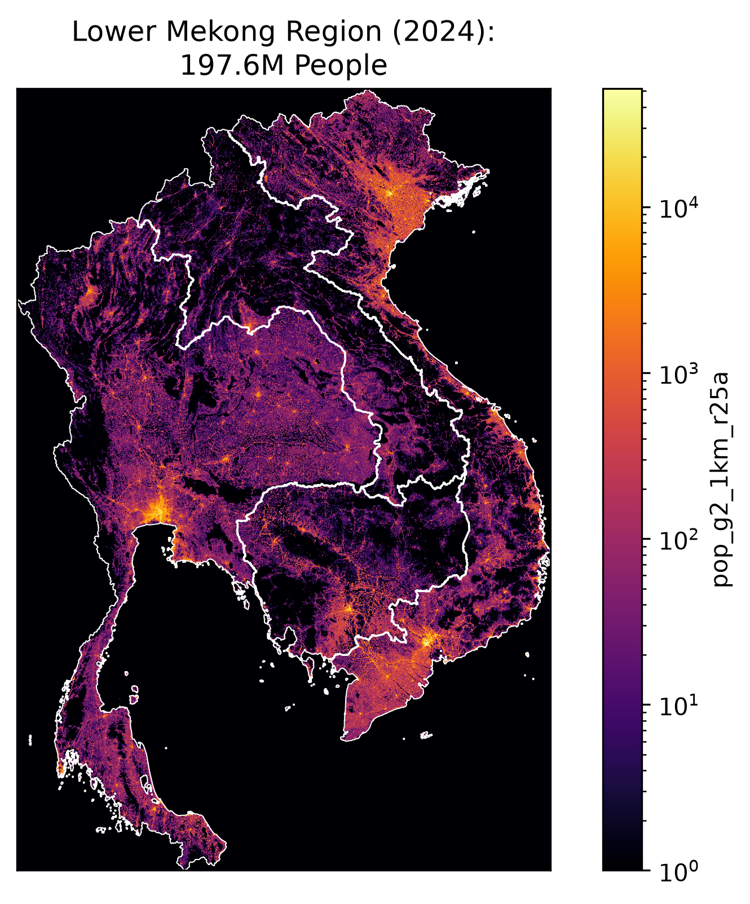
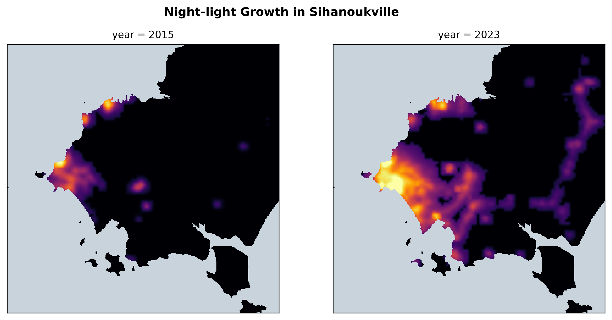
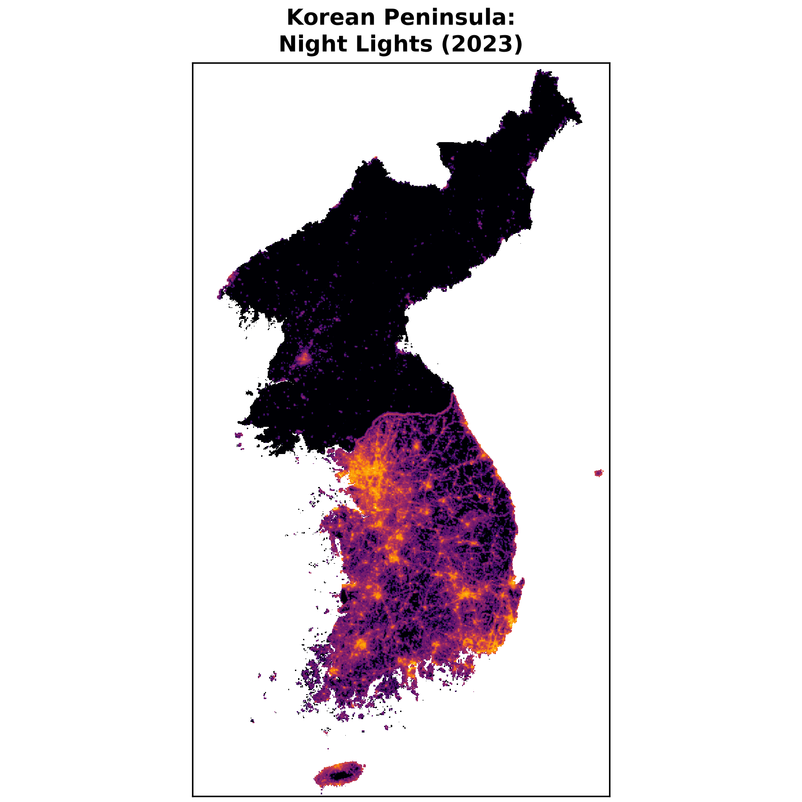
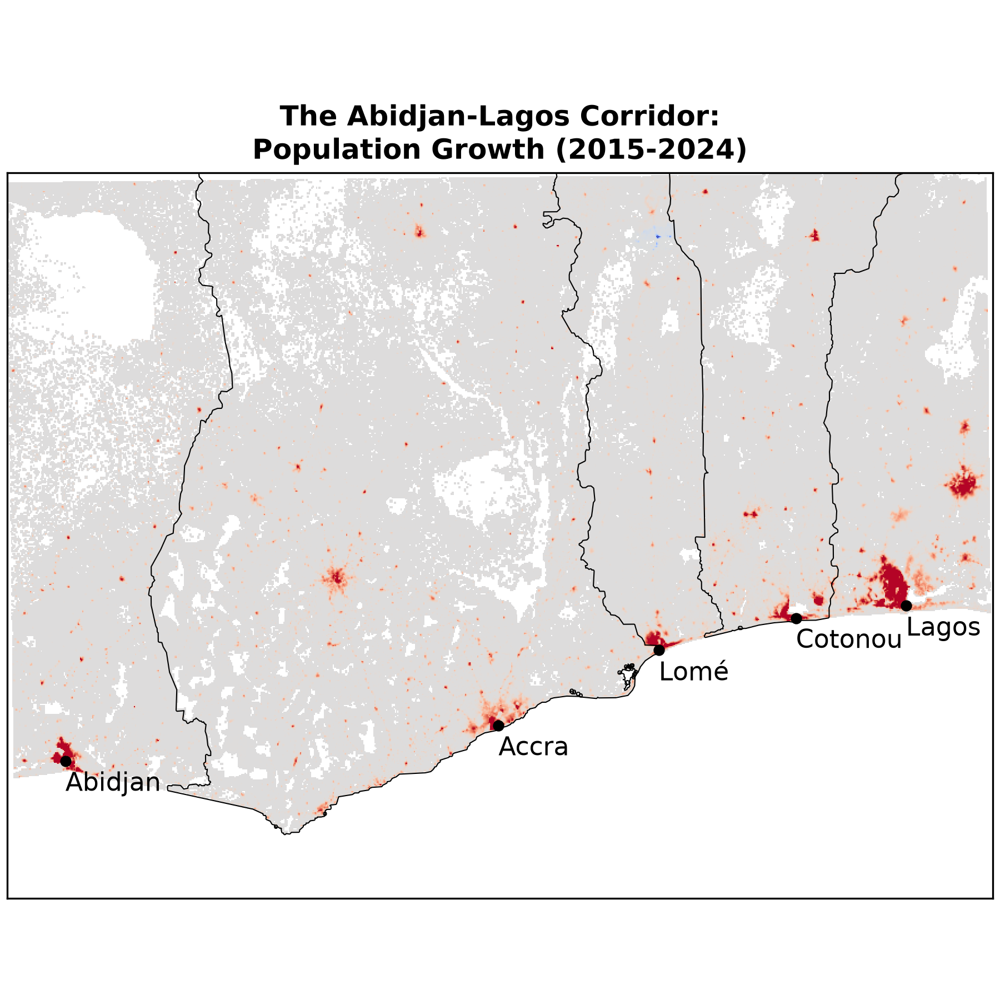
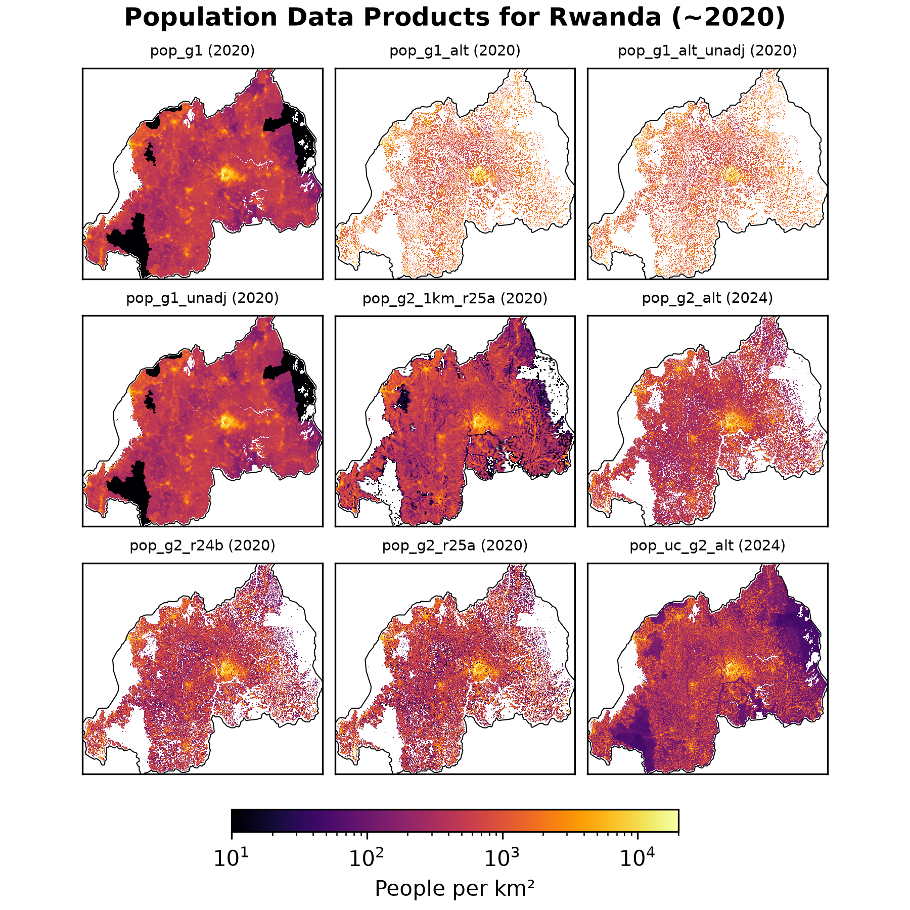
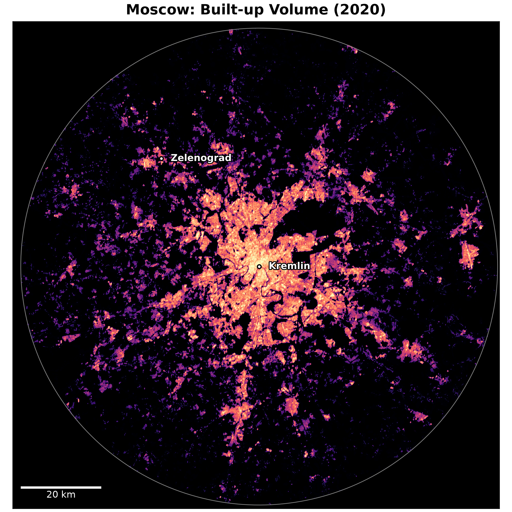
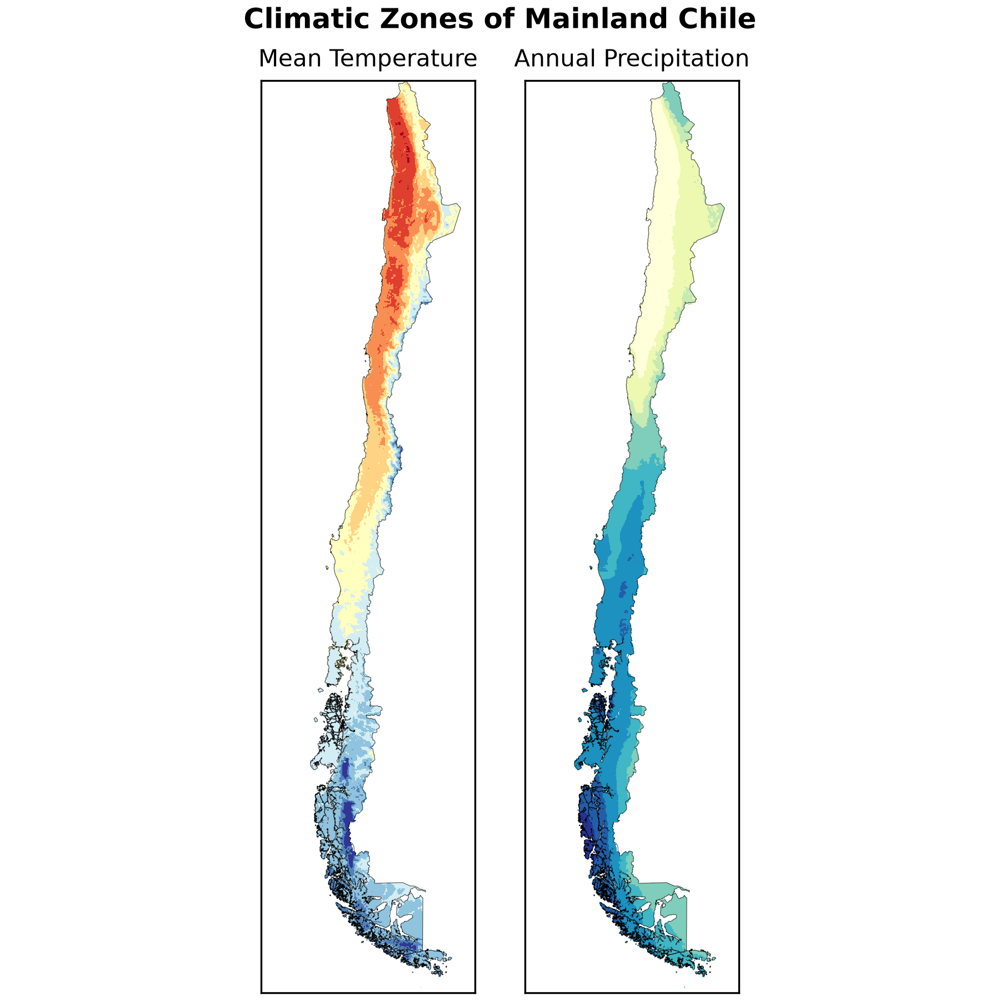
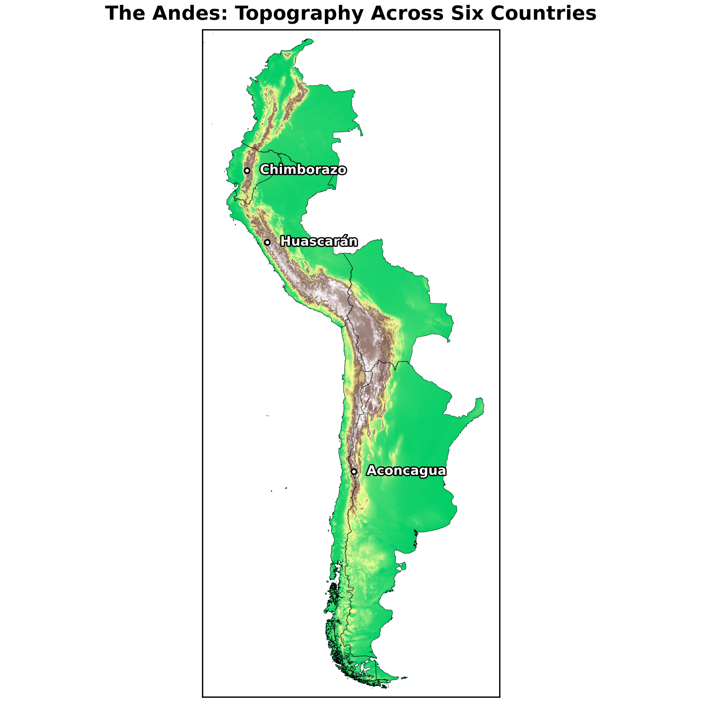

# WorldPopPy 

*A Python client for downloading, merging, and processing WorldPop raster data.*

<!-- 
Keywords: WorldPop Python package, download and combine WorldPop datasets, global raster data, population rasters, land cover rasters, night lights imagery, Python GIS toolkit
-->

[](https://pypi.org/project/WorldPopPy/)
[](https://pypi.org/project/WorldPopPy/)
[](https://github.com/lungoruscello/WorldPopPy/blob/master/LICENSE.txt)

**WorldPopPy** provides a programmatic interface to the [WorldPop](https://www.worldpop.org/) open data archive.

WorldPop offers global, gridded datasets on population dynamics, night-light emissions, topography, and much more. 
These datasets are typically distributed as individual files per country. **WorldPopPy** abstracts the process of
data discovery, retrieval, and preprocessing. Users query data by Area of Interest (AoI). The library automatically 
identifies the necessary country rasters, downloads them, and merges them into a unified dataset. For an area that
spans several countries, such as a river basin or a border region, a single call to `wp_raster` replaces finding,
downloading, merging, and clipping country files by hand.

See the **[Example Gallery](#example-gallery)** below for a visual overview of the library's capabilities.

## Key Features

* Fetch data for any region by passing country codes or names, bounding boxes, GeoDataFrames, shapely geometries, or vector files.
* Built-in memory optimisations for massive country rasters: read only what your AoI needs, and process large areas lazily with Dask.
* Easy handling of time-series through integration with [`xarray`](https://docs.xarray.dev/en/stable/).
* Provenance metadata on every result (source datasets, references, processing history).
* Parallel data downloads with automatic retry logic, local caching, and dry-run support.
* Searchable data manifest, allowing you to quickly find WorldPop products of interest.

## Installation

```bash
pip install worldpoppy
```

Or, in a project managed with [uv](https://docs.astral.sh/uv/):

```bash
uv add worldpoppy
```

## Quickstart
### Example 1: Merging Population Rasters for Several Countries 

```python
import matplotlib.pyplot as plt
from matplotlib.colors import LogNorm

from worldpoppy import wp_raster, clean_axes, plot_country_borders

# Fetch & Merge Data
# `wp_raster` returns an xarray.DataArray ready for analysis and plotting.
countries = ['THA', 'KHM', 'LAO', 'VNM']
pop_data = wp_raster(
    product_name='pop_g2_1km_r25a',  # Low-res. pop. estimates (Global 2 series)
    aoi=countries, years=2024
)

# Plot (Log-scale) 
# We use fillna(0) to represent areas without population and +1 to avoid log(0).
(pop_data.fillna(0) + 1).plot(norm=LogNorm(), cmap='inferno', size=6)

plot_country_borders(countries, edgecolor='white', linewidth=0.5)
clean_axes(title=f"Lower Mekong Region (2024):\n{pop_data.sum() / 1e6:.1f}M People")
plt.show()
```
 

### Example 2: Built-in Support for Time-series

```python
import matplotlib.pyplot as plt
from matplotlib.colors import LogNorm

from worldpoppy import wp_raster, bbox_from_location, clean_axes

# Fetch Two Years of Night-light Data for Sihanoukville (Cambodia)
ntl_data = wp_raster(
    product_name="ntl_viirs_g2",
    aoi=bbox_from_location("Sihanoukville Special Economic Zone", width_km=45),
    years=['first', 'last']  # Request first & last available year 
)

# Plot: Xarray can create a facet grid by year
p = (ntl_data + 1).plot(
    col="year", figsize=(10, 5),
    subplot_kws={"facecolor": "#c8d3dc"},  # sea (no data) in light grey-blue
    cmap="inferno", vmax=50, norm=LogNorm(),
    add_colorbar=False  # Remove since radiance units are not intuitive
)

p.fig.suptitle('Night-light Growth in Sihanoukville', fontsize=12, fontweight='bold')
p.fig.subplots_adjust(top=0.875)
clean_axes(p)
plt.show()
```


## Example Gallery

<table>
  <tr>
    <td width="50%" valign="top">
      <h3 align="center">1. Visualising Night Lights</h3>
      <div align="center">
        <a href="./examples/quickstart/03_korea_lights.py">
          
        </a>
      </div>
      <br>
      <div align="center">
        <b><a href="./examples/quickstart/03_korea_lights.py">The Korean Peninsula</a></b>
      </div>
      <div align="left">
        Quickly fetch, merge, and reproject night-light data for North and South Korea.
      </div>
    </td>
    <td width="50%" valign="top">
      <h3 align="center">2. Analysing Population Growth</h3>
      <div align="center">
        <a href="./examples/quickstart/04_west_africa_growth.py">
          
        </a>
      </div>
      <br>
      <div align="center">
        <b><a href="./examples/quickstart/04_west_africa_growth.py">The Abidjan-Lagos Corridor</a></b>
      </div>
      <div align="left">
        Visualise 10-year population change along the coast of West Africa.
      </div>
    </td>
  </tr>
</table>

<table>
  <tr>
    <td width="50%" valign="top">
      <h3 align="center">3. Exploring the Catalogue</h3>
      <div align="center">
        <a href="./examples/workflows/02_rwanda_pop_data_availability.py">
          
        </a>
      </div>
      <br>
      <div align="center">
        <b><a href="./examples/workflows/02_rwanda_pop_data_availability.py">Rwanda</a></b>
      </div>
      <div align="left">
        Find all population products available for a country and compare them side by side.
      </div>
    </td>
    <td width="50%" valign="top">
      <h3 align="center">4. Automatic Memory Optimisation</h3>
      <div align="center">
        <a href="./examples/large_rasters/01_moscow_built_volume.py">
          
        </a>
      </div>
      <br>
      <div align="center">
        <b><a href="./examples/large_rasters/01_moscow_built_volume.py">Greater Moscow</a></b>
      </div>
      <div align="left">
        Use any shapely geometry as the AoI. Only the cells near it are read, reducing memory load for large country rasters (here: about 1 GB instead of 84 GB).
      </div>
    </td>
  </tr>
</table>

<table>
  <tr>
    <td width="50%" valign="top">
      <h3 align="center">5. Manual Memory Optimisation</h3>
      <div align="center">
        <a href="./examples/large_rasters/02_chile_climate_dask.py">
          
        </a>
      </div>
      <br>
      <div align="center">
        <b><a href="./examples/large_rasters/02_chile_climate_dask.py">Mainland Chile</a></b>
      </div>
      <div align="left">
        Manually pre-clip a country raster to any box, e.g. without remote islands (here: 2 GB instead of 10 GB).
      </div>
    </td>
    <td width="50%" valign="top">
      <h3 align="center">6. Lazy Merging with Dask</h3>
      <div align="center">
        <a href="./examples/large_rasters/03_andes_topo_dask.py">
          
        </a>
      </div>
      <br>
      <div align="center">
        <b><a href="./examples/large_rasters/03_andes_topo_dask.py">The Andes</a></b>
      </div>
      <div align="left">
        Merge the elevation rasters of six countries lazily with Dask (here: an 11 GB grid in about 3 GB of memory).
      </div>
    </td>
  </tr>
</table>

## Working with Results

`wp_raster` returns an `xarray.DataArray` with geospatial metadata (handled by
[`rioxarray`](https://corteva.github.io/rioxarray/)). Results can therefore be analysed with xarray and saved as a
GeoTIFF:

```python
pop_data.rio.to_raster("mekong_pop_2024.tif")
```

Results are always in the coordinate reference system of WorldPop's source rasters (WGS84, EPSG:4326), whatever the
CRS of the area of interest. To reproject a result, use `wp_warp`. For counts such as population, use
`resampling='sum'` to approximately preserve totals:

```python
from worldpoppy import wp_warp

pop_warped = wp_warp(pop_data, to_crs="EPSG:32647", res=1_000, resampling="sum")
```

To combine results for different products or areas of interest (e.g., population and elevation), align one result to
the other first:

```python
elevation = elevation.rio.reproject_match(pop_data)
```

The cell coordinates of such results can differ by tiny floating-point amounts, and xarray, which matches cells by
exactly equal coordinates, would silently drop the cells that differ.

Every result carries WorldPop's recommended citations, the licence, and a processing history in its attributes.
Importantly, these attributes describe the result as returned by **WorldPopPy**. After you select data or compute new
values with xarray, some attributes no longer match the data (e.g., after selecting one year of a multi-year result,
`wpy_years` still lists all years). If you save such results, e.g. to pass the files on, update or drop these
attributes first. The [metadata guide](./docs/metadata.md) describes all attributes, and the
[metadata example](./examples/workflows/03_working_with_metadata.py) shows how to handle them.

## Finding Data

To simplify data discovery, **WorldPopPy** organises WorldPop's thousands of raw files into curated data products
with a consistent naming scheme. For example, `pop_g2_r25a` denotes population counts (`pop`) from WorldPop's
Global 2 series (`g2`), 2025 alpha release (`r25a`). Products cover population counts, night lights, 
elevation, land cover, and climate variables, among others, and many are available for several years. Use
`show_supported_data_products` for an overview, with a short description, the spatial resolution, and whether a
data product covers several years or is static. The overview can be filtered by keyword, country, or year:

```python
from worldpoppy import show_supported_data_products

# Print data products related to "population" from the Global 2 series 
show_supported_data_products(keywords=["population", "global2"])

# Print static (single-year) data products available for Brazil
show_supported_data_products(static_only=True, iso3_codes="BRA")
``` 

Alternatively, you can also get the library's full data manifest as a pandas DataFrame:

```python
from worldpoppy import wp_manifest

mdf = wp_manifest()
mdf.head()
```

To see which years and countries a data product covers, use `get_product_info`:

```python
from worldpoppy import get_product_info

info = get_product_info("ntl_viirs_g2")
sorted(info["years"])  # -> [2015, 2016, ..., 2023]
```

WorldPop organises its data by country, and **WorldPopPy** identifies countries by their three-letter ISO codes
(ISO 3166-1 alpha-3, e.g., "KEN" for Kenya). These codes select countries in `wp_raster`, `wp_manifest`,
`show_supported_data_products`, and `plot_country_borders`. To look up a country's code, search for (part of) its name.
The result lists all matching countries, exact matches first:

```python
from worldpoppy import find_country_code

find_country_code("ivory")
#   iso3           name matched_name
# 0  CIV  Côte d'Ivoire  Ivory Coast
```

`wp_raster` also accepts country names (e.g., `aoi="Kenya"`) if they match exactly one country, and reports the code 
it used. Ambiguous names such as "Congo" raise an error that lists the candidates.

## Documentation

* **API Reference:** https://worldpoppy.readthedocs.io/

* **Examples:** See the [`examples/`](./examples/) folder in this repository.

## Utilities

**WorldPopPy** includes helper functions to manage the local cache and download bandwidth.

### 1. Managing the Cache

Downloaded rasters are cached locally by default. You can change the location by setting the `WORLDPOPPY_CACHE_DIR` 
environment variable.

```python
from worldpoppy import purge_cache, get_cache_dir

# Print the cache directory
print(get_cache_dir())

# Check the size of the local cache (deletes nothing; see 'total_size_mb')
print(purge_cache(dry_run=True))

# Delete all downloaded rasters (keeps the cached country borders)
purge_cache(dry_run=False)

# Delete everything, incl. the country borders (rebuilt automatically when needed)
purge_cache(dry_run=False, keep_country_borders=False)
```

### 2. Download Dry Run

To estimate the size of a request before downloading, use the `download_dry_run` flag:

```python
from worldpoppy import wp_raster

# Prints a summary of files to be downloaded without fetching them
wp_raster(
    product_name='pop_g1', 
    aoi=['CAN', 'USA'], 
    years='all', 
    download_dry_run=True
)
```

## Data Usage & Attribution

**WorldPopPy** is a client for accessing data; it does not host or own the data. **WorldPopPy** is an independent
project and is not affiliated with or endorsed by WorldPop. Please note the following points regarding data provenance
and citation:

1. **Curated "Product Names"**: The product names used by this library (e.g., `pop_g1_alt` or `pop_g2_alt`) are 
specific to **WorldPopPy**; WorldPop does not use them. When citing data, please refer to WorldPop's official 
dataset titles (see `api_entry_title` below).

2. **Know Your Data:** While this library makes downloading and pre-processing easy, we strongly encourage you 
to understand what you are downloading. WorldPop datasets are often the result of complex modelling. Always check 
the `summary_url` provided in the manifest for details and further notes. To keep the load on WorldPop's servers 
low, **WorldPopPy** does not request the file listing of every raster dataset when building the manifest. Instead, 
we infer download and summary URLs from URL patterns, based on one sample dataset per data series, and only spot-check 
the results. If a summary link does not work, the official dataset title (`api_entry_title`) helps to find the page 
on WorldPop's website.

```python
from worldpoppy import wp_manifest

# Select country entries for one "product" using its curated WorldPopPy alias
mdf = wp_manifest(product_name='pop_g2_alt', iso3_codes='AFG')

# Inspect the raw metadata for one raster file (sourced from the WorldPop API)
row = mdf.iloc[0]

print(f"Source File Name:       {row.dataset_name}")
print(f"Official Dataset Title: {row.api_entry_title}")
print(f"Official Data Category: {row.api_series_category}")
print(f"Dataset Summary:        {row.summary_url}")  # Read this before using data!
print("-----")

# > The internal fields below are for data discovery in WorldPopPy
print(f"Library Product Name:   {row.product_name}")
print(f"Multi-year Product?     {row.multi_year}")
print(f"Library Product Notes:  {row.product_notes}")
```

3. **Cite the Source:** If you use this data, please cite its original creators ([WorldPop](https://www.worldpop.org/)). 
The scientific credit belongs to them. Note that the recommended citation style can differ between datasets, so be sure 
to check the `summary_url` for details.

## Acknowledgements

**WorldPopPy** is inspired by the World Bank's [BlackMarblePy](https://github.com/worldbank/blackmarblepy/tree/main) package, which provided the blueprint for 
this library's download module and informed the API design.

## Licence

This project is licensed under the [Mozilla Public License](https://www.mozilla.org/en-US/MPL/2.0/).
See [LICENSE.txt](./LICENSE.txt) for details.
