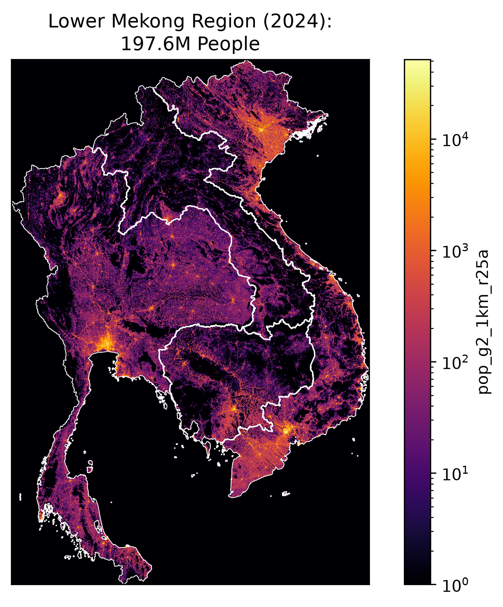
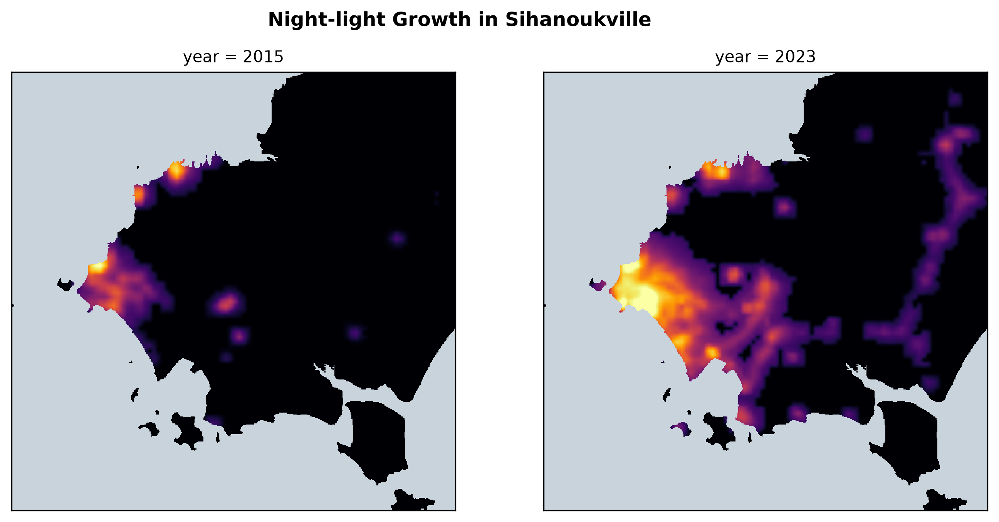
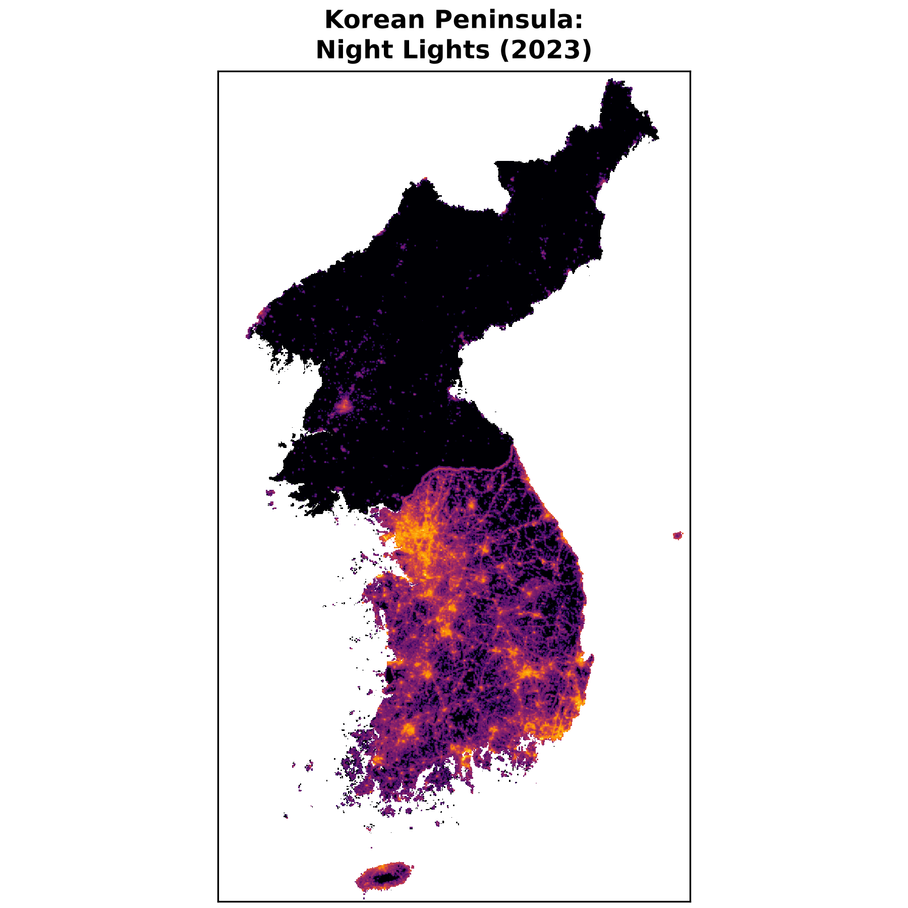
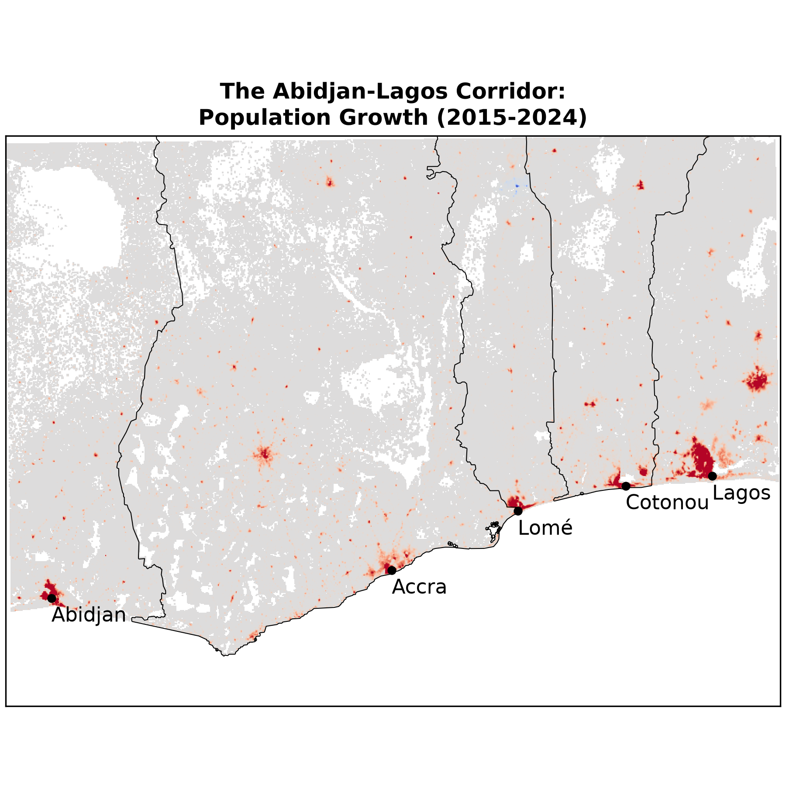
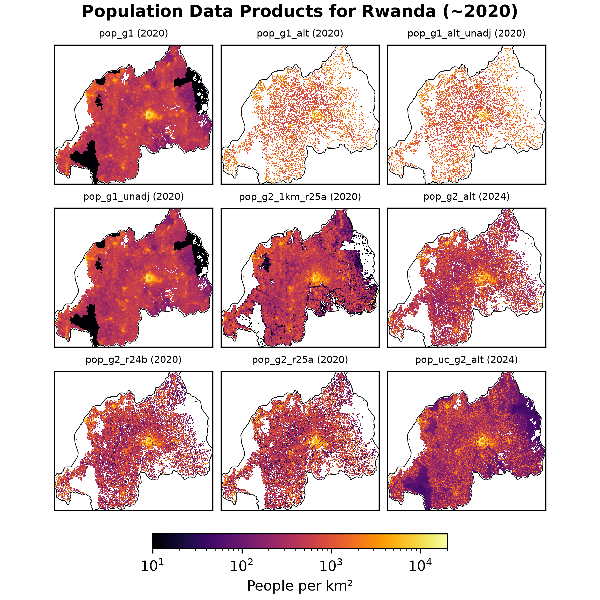
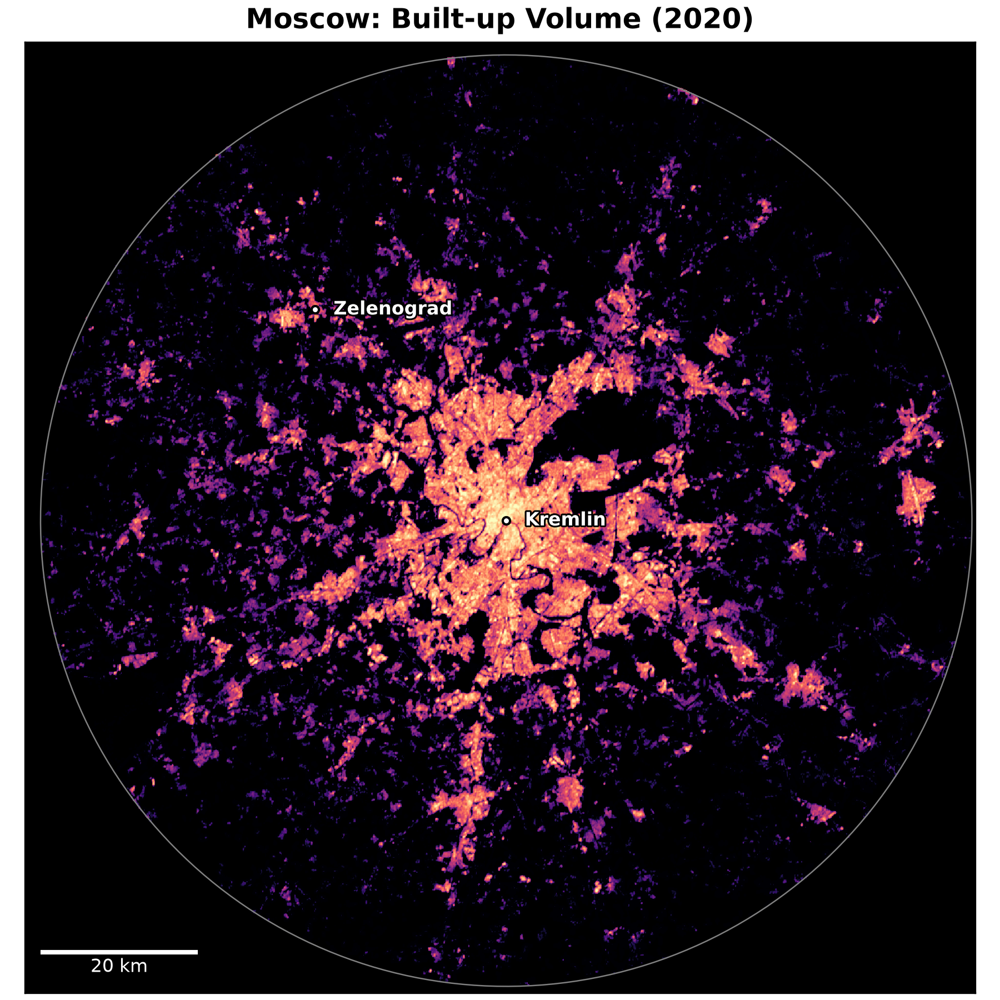
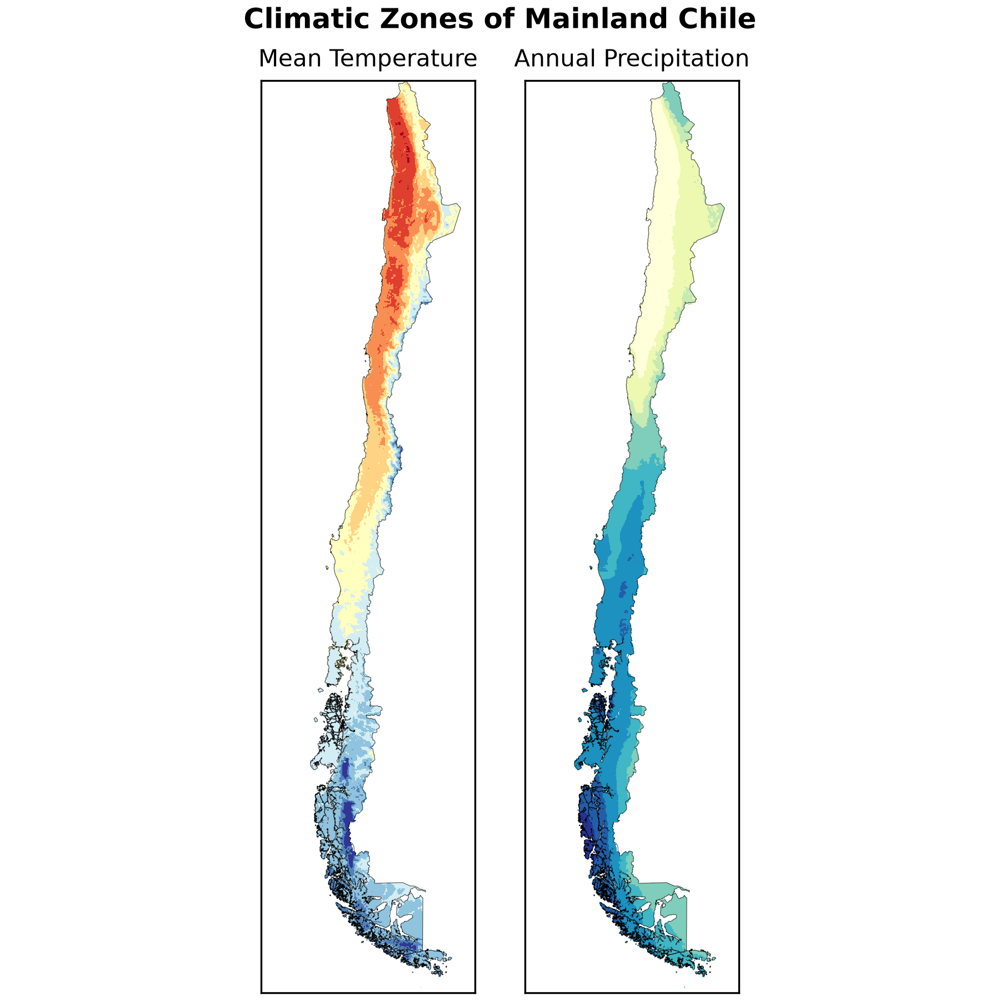
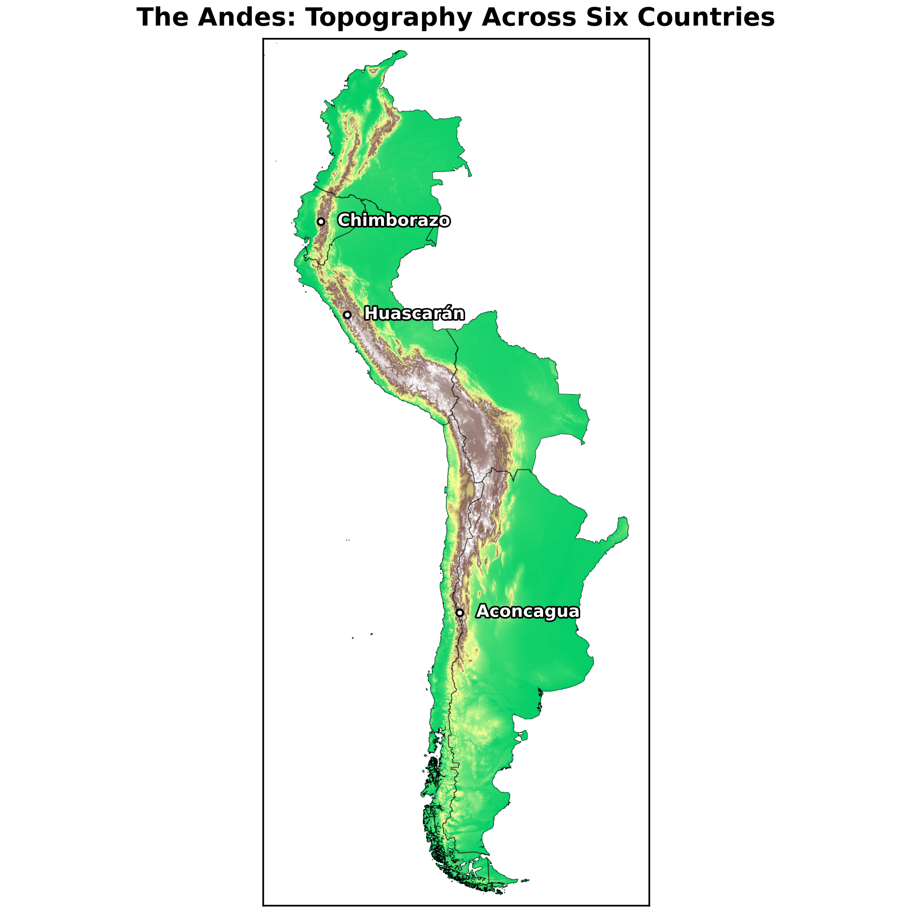

# WorldPopPy README

*A Python client for downloading, merging, and processing WorldPop raster data.*

<!-- 
Keywords: WorldPop Python package, download and combine WorldPop datasets, gridded population data, global raster data, population rasters, land-cover distance rasters, night lights imagery, elevation rasters, xarray, rioxarray, Dask, Python GIS toolkit
-->


**WorldPopPy** provides a programmatic interface to the [WorldPop](https://www.worldpop.org/) open data archive.

WorldPop offers global, gridded datasets on population dynamics, night-light emissions, topography, and much more. 
These datasets are typically distributed as individual files per country. **WorldPopPy** abstracts the process of
data discovery, retrieval, and preprocessing. Users query data by Area of Interest (AoI). The library automatically 
identifies the necessary country rasters, downloads them, and merges them into a unified dataset: an
`xarray.DataArray` with geospatial metadata. For an area that spans several countries, such as a river basin or a
border region, a single call to `wp_raster` replaces finding, downloading, merging, and clipping country files by hand.

See the **[Example Gallery](#example-gallery)** below for a visual overview of the library's capabilities.

## Key Features

* Fetch data for a region by passing country codes or names, bounding boxes, GeoDataFrames, shapely geometries, or vector files.
* Built-in memory optimisations for massive country rasters: read only what your AoI needs, and process large areas lazily with Dask.
* Easy handling of time-series through integration with [`xarray`](https://docs.xarray.dev/en/stable/).
* Provenance metadata on every result (source datasets, references, processing history).
* Parallel data downloads with automatic retry logic, local caching, and dry-run support.
* Searchable data manifest, allowing you to quickly find WorldPop products of interest.

## Installation

```bash
pip install worldpoppy
```

Or, in a project managed with [uv](https://docs.astral.sh/uv/):

```bash
uv add worldpoppy
```

## Quickstart
### Example 1: Merging Population Rasters for Several Countries 

```python
import matplotlib.pyplot as plt
from matplotlib.colors import LogNorm

from worldpoppy import wp_raster, clean_axes, plot_country_borders

# Fetch & Merge Data
# `wp_raster` returns an xarray.DataArray ready for analysis and plotting.
countries = ['THA', 'KHM', 'LAO', 'VNM']
pop_data = wp_raster(
    product_name='pop_g2_1km_r25a',  # Low-res. pop. estimates (Global 2 series)
    aoi=countries, years=2024
)

# Plot (Log-scale) 
# We fill empty cells with 0 and add 1 to avoid log(0).
(pop_data.fillna(0) + 1).plot(norm=LogNorm(), cmap='inferno', size=6)

plot_country_borders(countries, edgecolor='white', linewidth=0.5)
clean_axes(title=f"Lower Mekong Region (2024):\n{pop_data.sum() / 1e6:.1f}M People")
plt.show()
```
 

### Example 2: Built-in Support for Time-series

```python
import matplotlib.pyplot as plt
from matplotlib.colors import LogNorm

from worldpoppy import wp_raster, bbox_from_location, clean_axes

# Fetch Two Years of Night-light Data for Sihanoukville (Cambodia)
ntl_data = wp_raster(
    product_name="ntl_viirs_g2",
    aoi=bbox_from_location("Sihanoukville Special Economic Zone", width_km=45),
    years=['first', 'last']  # Request first & last available year 
)

# Plot: Xarray can create a facet grid by year
p = (ntl_data + 1).plot(
    col="year", figsize=(10, 5),
    subplot_kws={"facecolor": "#c8d3dc"},  # sea (no data) in light grey-blue
    cmap="inferno", vmax=50, norm=LogNorm(),
    add_colorbar=False  # Remove since radiance units are not intuitive
)

p.fig.suptitle('Night-light Growth in Sihanoukville', fontsize=12, fontweight='bold')
p.fig.subplots_adjust(top=0.875)
clean_axes(p)
plt.show()
```


## Example Gallery

<table>
  <tr>
    <td width="50%" valign="top">
      <h3 align="center">1. Visualising Night Lights</h3>
      <div align="center">
        <a href="https://github.com/lungoruscello/WorldPopPy/blob/master/examples/quickstart/03_korea_lights.py">
          
        </a>
      </div>
      <br>
      <div align="center">
        <b><a href="https://github.com/lungoruscello/WorldPopPy/blob/master/examples/quickstart/03_korea_lights.py">The Korean Peninsula</a></b>
      </div>
      <div align="left">
        Quickly fetch, merge, and reproject night-light data for North and South Korea.
      </div>
    </td>
    <td width="50%" valign="top">
      <h3 align="center">2. Analysing Population Growth</h3>
      <div align="center">
        <a href="https://github.com/lungoruscello/WorldPopPy/blob/master/examples/quickstart/04_west_africa_growth.py">
          
        </a>
      </div>
      <br>
      <div align="center">
        <b><a href="https://github.com/lungoruscello/WorldPopPy/blob/master/examples/quickstart/04_west_africa_growth.py">The Abidjan-Lagos Corridor</a></b>
      </div>
      <div align="left">
        Visualise population change from 2015 to 2024 along the coast of West Africa.
      </div>
    </td>
  </tr>
</table>

<table>
  <tr>
    <td width="50%" valign="top">
      <h3 align="center">3. Exploring the Catalogue</h3>
      <div align="center">
        <a href="https://github.com/lungoruscello/WorldPopPy/blob/master/examples/workflows/02_rwanda_pop_data_availability.py">
          
        </a>
      </div>
      <br>
      <div align="center">
        <b><a href="https://github.com/lungoruscello/WorldPopPy/blob/master/examples/workflows/02_rwanda_pop_data_availability.py">Rwanda</a></b>
      </div>
      <div align="left">
        Find all population products available for a country and compare them side by side.
      </div>
    </td>
    <td width="50%" valign="top">
      <h3 align="center">4. Automatic Memory Optimisation</h3>
      <div align="center">
        <a href="https://github.com/lungoruscello/WorldPopPy/blob/master/examples/large_rasters/01_moscow_built_volume.py">
          
        </a>
      </div>
      <br>
      <div align="center">
        <b><a href="https://github.com/lungoruscello/WorldPopPy/blob/master/examples/large_rasters/01_moscow_built_volume.py">Greater Moscow</a></b>
      </div>
      <div align="left">
        Use any shapely geometry as the AoI. Only the cells near it are read, reducing memory load for large country rasters (here: about 0.8 GB instead of 84 GB).
      </div>
    </td>
  </tr>
</table>

<table>
  <tr>
    <td width="50%" valign="top">
      <h3 align="center">5. Manual Memory Optimisation</h3>
      <div align="center">
        <a href="https://github.com/lungoruscello/WorldPopPy/blob/master/examples/large_rasters/02_chile_climate_dask.py">
          
        </a>
      </div>
      <br>
      <div align="center">
        <b><a href="https://github.com/lungoruscello/WorldPopPy/blob/master/examples/large_rasters/02_chile_climate_dask.py">Mainland Chile</a></b>
      </div>
      <div align="left">
        Manually pre-clip a country raster to any box, e.g. without remote islands (here: 2 GB instead of 10 GB).
      </div>
    </td>
    <td width="50%" valign="top">
      <h3 align="center">6. Lazy Merging with Dask</h3>
      <div align="center">
        <a href="https://github.com/lungoruscello/WorldPopPy/blob/master/examples/large_rasters/03_andes_topo_dask.py">
          
        </a>
      </div>
      <br>
      <div align="center">
        <b><a href="https://github.com/lungoruscello/WorldPopPy/blob/master/examples/large_rasters/03_andes_topo_dask.py">The Andes</a></b>
      </div>
      <div align="left">
        Merge the elevation rasters of six countries lazily with Dask (here: an 11 GB grid in about 2.8 GB of memory).
      </div>
    </td>
  </tr>
</table>

## Finding Data

To simplify data discovery, **WorldPopPy** organises WorldPop's thousands of raw files into curated data products
with a consistent naming scheme. For example, `pop_g2_r25a` denotes population counts (`pop`) from WorldPop's
Global 2 series (`g2`), 2025 alpha release (`r25a`). Products cover population counts, night lights, 
elevation, distances to land-cover classes, and climate variables, among others, and many are available for several
years. Use
`show_supported_data_products` for an overview, filtered by keyword, country, or year:

```python
from worldpoppy import show_supported_data_products

# Print data products related to "population" from the Global 2 series 
show_supported_data_products(keywords=["population", "global2"])
```

Countries are identified by their three-letter ISO codes (e.g. "KEN" for Kenya). To look up a country's code, search
for (part of) its name with `find_country_code`. `wp_raster` also accepts country names (e.g. `aoi="Kenya"`) if they
match exactly one country.

The guide [Finding Data](https://github.com/lungoruscello/WorldPopPy/blob/master/docs/finding_data.md) covers the full data manifest, the years and countries of each
product, and how to trace a product back to WorldPop's official datasets.

## Working with Results

`wp_raster` returns an `xarray.DataArray` with geospatial metadata (handled by
[`rioxarray`](https://vylor.github.io/rioxarray/)). Results can therefore be analysed with xarray and saved as a
GeoTIFF:

```python
pop_data.rio.to_raster("mekong_pop_2024.tif")
```

Results are always in the coordinate reference system of WorldPop's source rasters (WGS84, EPSG:4326), whatever the
CRS of the area of interest. To reproject a result, use `wp_warp`. For counts such as population, use
`resampling='sum'` to approximately preserve totals:

```python
from worldpoppy import wp_warp

pop_warped = wp_warp(pop_data, to_crs="EPSG:32647", res=1_000, resampling="sum")
```

A single call to `wp_raster` places all the rasters it combines on one grid. Results of separate calls need not lie on
exactly the same grid: before combining results for different areas of interest or products (e.g. population and
elevation), check that their grids match exactly, e.g. with `xr.align(a, b, join="exact")`, since xarray silently
drops cells whose coordinates differ. To align one result to the other, use `rio.reproject_match` (it resamples with
nearest neighbour by default; pass `resampling=` where the resolutions differ).

Every result carries WorldPop's recommended citations, the licence, and a processing history in its attributes.
Importantly, these attributes describe the result as returned by **WorldPopPy**. After you select data or compute new
values with xarray, some attributes no longer match the data. If you save such results, e.g. to pass the files on,
update or drop these attributes first.

The guides [Working with Results](https://github.com/lungoruscello/WorldPopPy/blob/master/docs/working_with_results.md) (incl. memory use for large areas) and
[Metadata of Results](https://github.com/lungoruscello/WorldPopPy/blob/master/docs/metadata.md) give the details.

## Documentation

* **User guides:** [Finding Data](https://github.com/lungoruscello/WorldPopPy/blob/master/docs/finding_data.md), [Working with Results](https://github.com/lungoruscello/WorldPopPy/blob/master/docs/working_with_results.md),
  [Metadata of Results](https://github.com/lungoruscello/WorldPopPy/blob/master/docs/metadata.md), [Cache and Downloads](https://github.com/lungoruscello/WorldPopPy/blob/master/docs/cache_and_downloads.md).
* **API Reference:** https://worldpoppy.readthedocs.io/
* **Examples:** See the [`examples/`](https://github.com/lungoruscello/WorldPopPy/blob/master/examples/) folder in this repository.

## Data Usage & Attribution

**WorldPopPy** is a client for accessing data; it does not host or own the data. **WorldPopPy** is an independent
project and is not affiliated with or endorsed by WorldPop. Please note the following points regarding data provenance
and citation:

1. **Curated "Product Names"**: The product names used by this library (e.g. `pop_g1_alt` or `pop_g2_alt`) are 
specific to **WorldPopPy**; WorldPop does not use them. When citing data, please refer to WorldPop's official 
dataset titles (see [Finding Data](https://github.com/lungoruscello/WorldPopPy/blob/master/docs/finding_data.md#tracing-a-product-to-worldpops-datasets)).

2. **Know Your Data:** While this library makes downloading and pre-processing easy, we strongly encourage you 
to understand what you are downloading. WorldPop datasets are often the result of complex modelling. Always check 
the summary page of each dataset (`summary_url` in the manifest) for details and further notes.

3. **Cite the Source:** If you use this data, please cite its original creators ([WorldPop](https://www.worldpop.org/)). 
The scientific credit belongs to them. Note that the recommended citation style can differ between datasets, so be sure 
to check the `summary_url` for details.

## Acknowledgements

**WorldPopPy** is inspired by the World Bank's [BlackMarblePy](https://github.com/worldbank/blackmarblepy/tree/main) package, which provided the blueprint for 
this library's download module and informed the API design.

## Licence

This project is licensed under the [Mozilla Public License](https://www.mozilla.org/en-US/MPL/2.0/).
See [LICENSE.txt](https://github.com/lungoruscello/WorldPopPy/blob/master/LICENSE.txt) for details.
